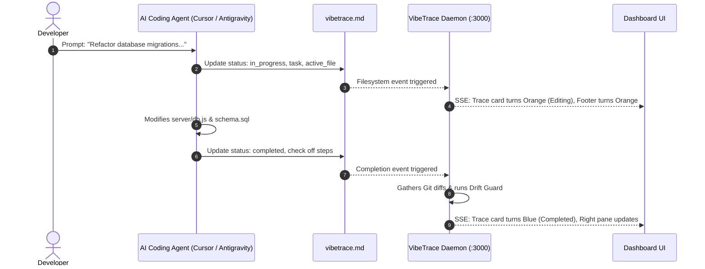

# VibeTrace ⚡


### Real-Time Observability Harness & Prompt-to-Execution Drift Guard for AI Coding Agents

[](LICENSE)
[](https://nodejs.org/)
[](https://openrouter.ai/)
[-orange.svg)](https://nodejs.org/api/sqlite.html)
[]()

> **VibeTrace** transforms black-box AI code generation into an industrial, transparent, and verified engineering workflow. Running side-by-side with your IDE, VibeTrace watches file mutations in real time, synchronizes with AI coding agents through an active communication protocol (`vibetrace.md`), audits prompt-to-output fidelity with OpenRouter, and flags unintended architectural or configuration drift before it reaches production.

---

## 🌟 Why VibeTrace?

When "vibe-coding" with AI agents (such as Antigravity, Cursor, Claude Code, or Copilot), developers face the **Black Box Drift Problem**:
- Agents write code quickly, but frequently introduce unrequested changes: silent permission shifts, altered environment keys, stripped visual design systems, deleted existing features, or scope creep.
- Standard git diffs are raw and noisy, lacking semantic awareness of what the developer originally asked for.

**VibeTrace solves this** by acting as an autonomous observability harness:
1. **Passive Telemetry:** Watches your repository with sliding debouncing and instant git diff extraction.
2. **Active Protocol (`vibetrace.md`):** Agents declare their task, intent, active file, and checklist steps.
3. **Independent Drift Guard:** Uses OpenRouter AI (or local heuristic engines) to independently compare user prompt intent against produced code diffs, alerting you to regressions and design downgrades in real time.
4. **Rich 3-Pane Workbench:** Provides immediate, high-density visualization of code impact, downstream ripple effects, and architectural flaws.

---

## 🚀 Key Features

### 1. 4-State Dynamic Gradient Trace Cards
Execution traces in the timeline visually broadcast their lifecycle state using curated CSS gradients:
- 🟡 **Working (Golden Amber):** Agent initialized the task and is actively inspecting or planning.
- 🟠 **Editing (Tangerine Orange):** Real-time file mutation active in the workspace with live line delta.
- 🔵 **Completed (Sapphire Blue):** Task successfully completed with 100% verified fidelity to prompt intent.
- 🔴 **Difference / Diverged (Crimson Red):** Discrepancies or unrequested modifications detected between prompt and output code.

### 2. Independent Prompt-to-Output Drift Guard
- Evaluates prompt intent vs. actual mechanical code modifications.
- Flags unrequested file mutations, breaking configuration edits, and design downgrades.
- Produces an **Alignment Score (0–100%)**, a **Risk Rating (LOW, MEDIUM, HIGH, CRITICAL)**, and concrete remediation steps.
- Zero false alarms: Aligned code remains strictly verified with sapphire blue styling.

### 3. Edge-to-Edge Resizable 3-Pane Workbench
- **Left Pane (Chronological Feed):** Borderless execution trace stream, live search/filter, repository path with one-click copy, and live trace counter.
- **Center Pane (Active File Inspector & Diff Viewer):** Unified syntax diffs with line additions/deletions, per-file change analysis, and affected scope chips.
- **Right Pane (Dual-Perspective Intelligence):**
  - *Perspective 1 (AI Synthesis & Drift Guard):* Plain-English overview, mechanical changes, affected features, downstream ripple effect, and Drift Guard audit.
  - *Perspective 2 (Agent Plan & Harness Audit):* Agent checklist steps from `vibetrace.md`, mechanical AST/harness audits, and live latency/model telemetry.

### 4. 6-State Footer Observability Engine & Live Logs Drawer
- Bottom status bar reflects 6 live system states with animated pulsing dots:
  - `WORKING` (Amber) | `EDITING` (Orange) | `ANALYZING` (Violet) | `COMPLETED` (Blue) | `DIFFERENCE` (Red) | `IDLE` (Green).
- Monospace timestamped log ticker streams workspace events, debouncing updates, and drift audits.
- **Slide-up Live Observability Logs Drawer:** Clickable drawer console with real-time log stream, category pills (`[MUTATION]`, `[PROTOCOL]`, `[HARNESS]`, `[DRIFT]`, `[TRACE]`), and instant clear controls.

### 5. Features Over Time: Chronological Evolution Graph & Milestones
- Click the **Features Over Time** button in the header to view an interactive full-screen evolution graph visualizing the cumulative progression of files mutated, lines added/removed, and architectural milestones over time.
- Categorizes mutations into structural domains (`Frontend & UI`, `Backend & APIs`, `Protocol & Harness`, `AI & Telemetry`, `Design System`) with interactive SVG trend curves and SQLite persistence across server restarts.

### 6. Interactive Trace Analysis & Deep AST Q&A Engine
- Ask questions directly about any observed code change in the right pane ("What was changed?", "Downstream impact?", "Breaking changes?").
- **Dual-mode architecture:** Seamlessly queries OpenRouter AI models or executes sub-30ms offline semantic AST and diff parsing to deliver precise, technical markdown breakdowns even during cloud API rate limits.

### 7. Resilient AI Engine (Strict `.env` Binding + Offline Heuristic Fallback)
- **Strictly Model-Bound:** OpenRouter queries are strictly locked to `process.env.OPENROUTER_API_MODEL`. Zero unauthorized fallback models or surprise API consumption.
- **Offline Heuristics:** If OpenRouter is offline, unconfigured, or rate-limited (HTTP 429), VibeTrace seamlessly switches to embedded local heuristic engines, preserving 100% dashboard functionality without crashes.

### 8. Persistent SQLite Telemetry
- All traces, diffs, protocol states, and query responses are saved permanently to `vibetrace.db` using Node.js native `node:sqlite`. Traces persist across server restarts.

---

## 📂 Project Organization

VibeTrace source code is cleanly separated from the Devpost hackathon curriculum:

```
learn-ai-basics/
├── .env.example              # Template for OpenRouter credentials & port
├── LICENSE                   # Official MIT License
├── README.md                 # Complete VibeTrace documentation (this file)
├── package.json              # Express, Chokidar, simple-git, dotenv
├── vibetrace.md              # Live inter-agent communication protocol file
├── vibetrace.db              # SQLite persistent telemetry storage
│
├── public/                   # Frontend Dashboard
│   ├── index.html            # 3-Pane workbench & logs drawer DOM
│   ├── style.css             # High-density SaaS typography & status gradients
│   ├── app.js                # SSE client, trace rendering, right pane binding
│   └── diffViewer.js         # Client-side syntax diff renderer & inspector
│
├── server/                   # Backend Observability Harness
│   ├── index.js              # Express REST API & SSE telemetry broadcast
│   ├── watcher.js            # Real-time sliding debounce file watcher
│   ├── db.js                 # SQLite persistent storage (node:sqlite)
│   ├── analyzer.js           # Trace synthesis engine with OpenRouter & fallback
│   ├── driftAnalyzer.js      # Independent prompt-to-output drift & risk auditor
│   ├── queryEngine.js        # Natural language & local AST semantic Q&A engine
│   ├── featureTimelineEngine.js # Features Over Time & milestone evolution engine
│   ├── mindMapEngine.js      # Architectural subsystem mapper & flaw scanner
│   ├── gitService.js         # Git diff extractor & branch inspector
│   └── harness/              # Agent protocol reader & mechanical AST validator
│
├── skills/
│   └── vibetrace/            # The Agent Skill for Antigravity, Cursor & Claude
│       ├── SKILL.md          # Complete agent instructions, protocol & guardrails
│       └── ...
│
└── devpost/                  # Competition Submission Artifacts
    ├── scope.md              # Project scope & boundaries
    ├── prd.md                # Product requirements & user journeys
    ├── spec.md               # Technical specification & architecture
    ├── checklist.md          # Build verification checklist
    ├── learner-profile.md    # Learner onboarding profile
    └── app-map.html          # Interactive application tour & map
```

---

## 🛠️ Quick Start

### 1. Prerequisites
- **Node.js 18+** (uses native `fetch` and `node:sqlite`)
- **Git** installed and available in PATH

### 2. Installation
```bash
git clone https://github.com/bilal-extroverted/Vibe-Trace.git
cd Vibe-Trace
npm install
```

### 3. Configure Environment
Copy the example environment file:
```bash
cp .env.example .env
```
Edit `.env` with your settings:
```ini
# OpenRouter API Key for AI causal summaries & drift auditing (optional)
OPENROUTER_API_KEY=your-openrouter-key-here

# OpenRouter Model (must match exact model string on openrouter.ai)
OPENROUTER_API_MODEL=recursive/flint-v1.0:free

# Server Port
PORT=3000

# Watched Project Directory (defaults to current repo root)
WATCH_DIR=.
```
*(Note: If `OPENROUTER_API_KEY` is omitted, VibeTrace automatically runs in offline heuristic mode).*

### 4. Start VibeTrace
```bash
npm start
# or for development:
npm run dev
```
Open your browser to:
👉 **`http://localhost:3000`**

---

## 🤖 Using the `vibetrace` Skill with AI Coding Agents

VibeTrace includes a specialized **Agent Skill** (`skills/vibetrace/SKILL.md`) compatible with Google Antigravity, Cursor, Claude Code, and Codex.

### How It Works
When you prompt your AI coding agent, the agent reads `vibetrace.md` to communicate its lifecycle state directly to the VibeTrace dashboard.



### Agent Best Practices & Protocol Format
When equipping an agent with `skills/vibetrace/SKILL.md`, the agent maintains `vibetrace.md` in the project root:

```markdown
---
status: in_progress           # 'working' | 'in_progress' | 'completed'
task: "Add OAuth2 authentication provider"
agent: "Antigravity AI"
active_file: "server/auth.js"
file_action: "Implementing Google OAuth callback handler"
file_summary: "Added exchangeToken() and verifyProfile() functions"
started_at: "2026-10-25T10:00:00.000Z"
updated_at: "2026-10-25T10:05:00.000Z"
---

# VibeTrace Agent-Harness Communication Protocol

## Current Task Intent
> Brief 1-2 sentence description of user prompt intent and expected changes.

## Execution Plan & Steps
- [x] Step 1: Install oauth client dependencies
- [ ] Step 2: Configure callback routes in server/auth.js
- [ ] Step 3: Test authentication flow

## Inter-Agent & Harness Communication Notes
- Do not modify frontend styles during this backend authentication task.
```

### Agent Rules & Guardrails
1. **Never Start Silently:** Update `vibetrace.md` with `status: in_progress` and your declared task *before* modifying code files.
2. **Track Active Files:** As you touch different files, update `active_file` and `file_action` so the dashboard's live ticker accurately reflects your progress.
3. **Signal Completion:** When finished, set `status: completed` and check all completed step boxes. This instructs VibeTrace to aggregate git diffs, run the Drift Guard audit, and publish the verified trace.
4. **Prevent Drift:** If the user asked for a backend change, do not touch CSS or layout files. Drift Guard actively detects unauthorized scope changes and flags them in red.

---

## 📡 REST & SSE API Reference

| Endpoint | Method | Description |
|---|---|---|
| `/api/events` | `GET` (SSE) | Real-time Server-Sent Events stream for traces, active files, logs, and protocol changes |
| `/api/status` | `GET` | System health, active watcher status, project path, event count, and configured AI model |
| `/api/traces` | `GET` | Fetches historical execution traces with full diffs, audits, and synthesis data |
| `/api/projects` | `GET` | Lists all observed projects stored in SQLite |
| `/api/features-over-time` | `GET` | Generates chronological milestone evolution graph, feature additions/deletions, and trend charts |
| `/api/mindmap` | `GET` | Subsystem architecture map, flaw scanner, and recommendations (alias to timeline) |
| `/api/analyze-drift`| `POST` | Re-runs independent OpenRouter prompt-to-output drift audit on demand |
| `/api/query` | `POST` | Natural language question answering with deep local AST and diff semantic analysis |

---

## 📄 License

This project is licensed under the **MIT License** — see the [LICENSE](LICENSE) file for details.

Copyright (c) 2026 Muhammad Bilal and VibeTrace Contributors.
