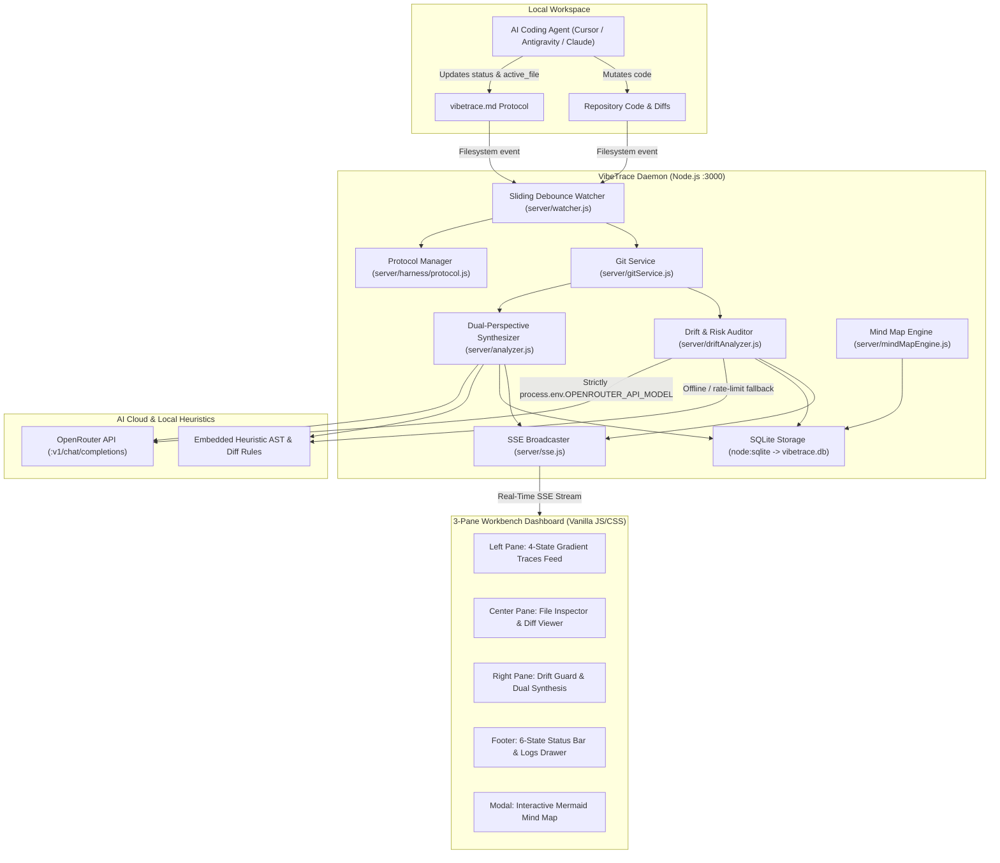

# VibeTrace — Technical Blueprint & Architecture Specification

A local-first, side-by-side observability dashboard and autonomous protocol harness that connects to a local Git repository, watches AI coding mutations with sliding-window debounced telemetry, manages inter-agent task lifecycles via `vibetrace.md`, and queries the OpenRouter API (strictly bound to `.env`) alongside local heuristic engines to provide dual-perspective execution synthesis, 4-state gradient trace cards, and independent prompt-to-output drift auditing.

---

## 1. System Architecture Overview

VibeTrace consists of six core subsystem layers working in harmony:

---

## 2. Core Architectural Subsystems

### 2.1 Workspace Watcher & Sliding Debouncer (`server/watcher.js`)
- Initializes `chokidar` on `WATCH_DIR`, automatically filtering `.git`, `node_modules`, lockfiles, and `.env`.
- Uses a **sliding debounce window** (500ms) with a 2000ms max-wait ceiling to batch bursty multi-file modifications from AI agents into a single unified trace.
- Intercepts `vibetrace.md` updates instantly without debouncing:
  - `status: in_progress` or `status: working` triggers immediate Amber `working` trace creation.
  - `active_file` transitions broadcast Orange `editing` updates with live line deltas.
  - `status: completed` immediately triggers git diff extraction, AST validation, and permanent trace publication.

### 2.2 Inter-Agent Communication Protocol (`server/harness/protocol.js` & `vibetrace.md`)
- Employs `vibetrace.md` in the project root as a zero-dependency, human-readable IPC communication bus between coding agents and VibeTrace.
- Frontmatter specification:
  - `status`: `"working"` | `"in_progress"` | `"completed"`
  - `task`: Short summary of user prompt intent.
  - `agent`: Name of the AI agent (e.g., `"Antigravity AI"`).
  - `active_file`: Relative file path currently being modified.
  - `file_action`: Action description (e.g., `"Adding rate-limiting middleware"`).
  - `file_summary`: Technical consequence.
  - `started_at` / `completed_at` / `updated_at`: ISO 8601 timestamps.
- Body specification:
  - `## Current Task Intent`
  - `## Execution Plan & Steps` (`- [x]` completed / `- [ ]` pending checkboxes)
  - `## Inter-Agent & Harness Communication Notes`

### 2.3 Independent Prompt-to-Output Drift Guard (`server/driftAnalyzer.js`)
- Objective, independent fidelity auditor comparing user prompt intent against produced code diffs.
- **Strict OpenRouter Binding:** Queries strictly `process.env.OPENROUTER_API_MODEL`. Zero fallback model cascading or unauthorized remote calls.
- **Resilient Offline Heuristic Rules:** If OpenRouter returns HTTP 429 or is unconfigured, embedded heuristic rules immediately evaluate:
  - *Design Downgrades:* Deletion of `linear-gradient` or layout styles without explicit instruction.
  - *Scope Creep:* Backend files modified during frontend styling tasks, or vice versa.
  - *Blanket Overrides:* Destructive broad CSS selectors clobbering multi-state UI feedback.
  - *Hardcoded Values:* Hardcoded credentials/models instead of dynamic `process.env` lookups.
- Outputs a normalized JSON payload:
  `hasDifference`, `alignmentScore` (0–100%), `riskLevel` (`LOW`, `MEDIUM`, `HIGH`, `CRITICAL`), `hasSignificantIssue`, `alertLevel`, `alertTitle`, `alertMessage`, `discrepancies`, `unrequestedChanges`, `missingRequirements`, and `suggestedRemedy`.

### 2.4 Trace Synthesizer & Dual-Perspective Engine (`server/analyzer.js`)
- Generates comprehensive trace artifacts containing:
  - *Perspective 1 (AI Synthesis):* Title, plain-English summary, mechanical changes list, affected features, and downstream systemic ripple effects.
  - *Perspective 2 (Agent Plan & Checks):* Protocol steps checklist, active file mutations, and mechanical harness audits (Syntax Check, AST Integrity, Sensitive Files, File Count, Line Delta).
  - *Per-File Analysis:* Extracts touched symbols, function signatures, additions, and deletions for each file in the diff.

### 2.5 Persistent SQLite Telemetry Layer (`server/db.js`)
- Built using Node.js native `node:sqlite` (`DatabaseSync`), requiring zero third-party database drivers or native compilation.
- Persists all entities in `vibetrace.db`:
  - `projects`: Watched repositories, paths, and activity timestamps.
  - `traces`: Complete JSON snapshots of synthesis, protocol, drift analysis, and git context.
  - `diffs`: Individual file diffs with foreign key cascade to parent trace.
  - `queries`: Historical natural language Q&A interactions.

### 2.6 Real-Time SSE Telemetry Broadcaster (`server/sse.js`)
- Streams structured JSON events to all connected clients over a persistent HTTP SSE connection (`/api/events`):
  - `trace`: Permanent completed trace artifact.
  - `trace_active`: Live in-progress trace update.
  - `agent_status`: State transition (`working`, `writing`, `analyzing`, `completed`, `idle`).
  - `protocol_update`: Parsed `vibetrace.md` payload.
  - `drift_update`: Re-audited drift report.
  - `log`: Timestamped activity ticker messages with category tags (`mutation`, `protocol`, `harness`, `drift`, `trace`, `ai`).

### 2.7 3-Pane Edge-to-Edge Workbench (`public/`)
- **Left Pane:** Chronological execution traces feed with search filter, repository path with click-to-copy, and 4-state dynamic CSS gradient cards:
  - 🟡 Working: Amber glow gradient (`#d97706`).
  - 🟠 Editing: Tangerine orange gradient (`#ea580c`).
  - 🔵 Completed: Sapphire blue gradient (`#2563eb`).
  - 🔴 Diverged / Difference: Crimson alert gradient (`#dc2626`).
- **Center Pane (`public/diffViewer.js`):** Unified visual diff renderer with line additions/deletions, syntax coloring, file jump pills, and "What Changed in This File" mechanical analysis.
- **Right Pane:** Declared Prompt Card, Drift Guard Audit, AI Model Synthesis, Agent Execution Plan checklist, Mechanical Harness Checks, and Performance Telemetry.
- **Footer Status Engine & Drawer:** 6-state pulsing status indicator, real-time activity ticker, and slide-up `#logs-drawer` terminal console with live stream badge and clear controls.
- **Mind Map Modal (`server/mindMapEngine.js`):** Full-screen overlay rendering dynamic Mermaid architecture diagrams, subsystem classification, flaw detection, and systemic recommendations.

---

## 3. Technology Stack

| Component | Technology | Version | Purpose |
|---|---|---|---|
| **Runtime** | Node.js | v18+ | Native `fetch`, `node:sqlite`, and ESM/CJS runtime |
| **Server** | Express.js | v4.19+ | REST endpoints, static dashboard serving, and SSE streaming |
| **Filesystem Watcher** | Chokidar | v3.6+ | Cross-platform filesystem mutation watching with sliding debounce |
| **Git Integration** | Simple-Git | v3.25+ | Programmatic inspection of `git diff`, `git log`, and `git status` |
| **Database** | `node:sqlite` | Native | Zero-dependency, crash-resilient persistent SQLite storage (`vibetrace.db`) |
| **AI Cloud** | OpenRouter API | REST | OpenAI-compatible endpoint strictly bound to `OPENROUTER_API_MODEL` |
| **Styling** | Vanilla CSS | Modern | Custom design system, CSS variables, glassmorphic filters, and gradients |
| **Diagrams** | Mermaid.js | CDN | Dynamic rendering of architectural subsystem mind maps |

---

## 4. Failure Modes & Resilience Engineering

1. **OpenRouter Rate Limits (HTTP 429) or Network Outages:**
   The system never crashes or hangs. If upstream APIs return errors, VibeTrace immediately logs a warning to the footer ticker and seamlessly falls back to embedded AST/diff heuristics. The dashboard continues rendering 100% of all UI panels.
2. **Rapid File Mutation Bursts:**
   Chokidar's sliding debounce batches bursts into a single atomic change event, preventing event storms or partial diff corruption.
3. **Mismatched Task Lifecycle States:**
   If an agent starts editing before updating `vibetrace.md`, the Drift Guard's heuristic rules detect cross-boundary touches (e.g. backend edits during frontend tasks) and immediately flag a divergence alert, prompting the developer to realign intent.
4. **Zero-Build Frontend:**
   The frontend runs directly in browser without Vite, Webpack, or Babel build steps, guaranteeing instantaneous startup and zero bundle corruption.
